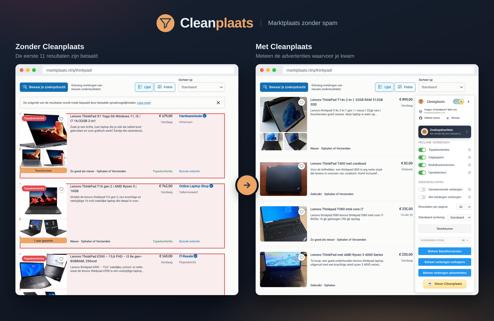
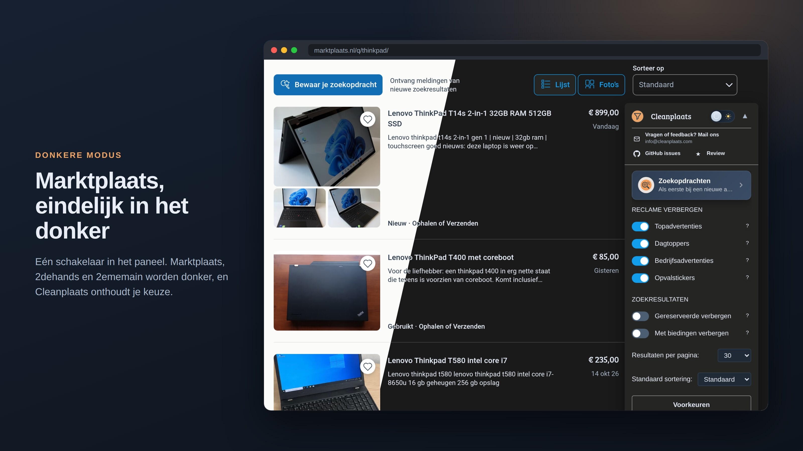

<p align="center">
  
</p>

<p align="center">
  <a href="https://chromewebstore.google.com/detail/cleanplaats-marktplaats-z/peebdbeclpkljmfocjifjpjlngfpfhjp"></a>
  <a href="https://addons.mozilla.org/nl/firefox/addon/cleanplaats-marktplaats-filter/"></a>
  
</p>

# Cleanplaats

Cleanplaats is een browserextensie voor [Marktplaats](https://www.marktplaats.nl/), [2dehands](https://www.2dehands.be/) en [2ememain](https://www.2ememain.be/). Jij bepaalt wat een zoekpagina je mag laten zien: geen topadvertenties, dagtoppers, winkels of opvalstickers meer, alleen de advertenties waarvoor je kwam.

*Hierboven: echte zoekresultaten voor "thinkpad" op 20 oktober 2026. Links zijn de betaalde plaatsingen en bedrijfsadvertenties voor de duidelijkheid rood omlijnd. Op de eerste pagina van "lego" was die dag zelfs elke advertentie betaald.*

## Wat doet Cleanplaats?

**Reclame verbergen**

- Topadvertenties, dagtoppers (topzoekertjes op 2dehands), bedrijfsadvertenties en advertenties met opvalstickers of een "Moet nu weg"-label
- Ook de winkels in "Voor jou" en "In je buurt" op de homepage
- Reclamebanners en de trackers van de advertentieketen worden geblokkeerd voordat ze laden

**Zoekresultaten naar jouw hand**

- Verberg gereserveerde advertenties, of advertenties waar al op geboden is
- Verberg een verkoper of een losse advertentie met één klik, vanaf de zoekresultaten, de homepage of de advertentiepagina zelf
- Blacklist-termen voor titels en beschrijvingen
- 30, 50 of 100 resultaten per pagina en een vaste standaardsortering
- Is een pagina helemaal leeg gefilterd, dan zoekt Cleanplaats zelf de volgende pagina met zichtbare advertenties
- Markeer advertenties die je eerder al hebt geopend

**Zoekopdrachten**

- Cleanplaats blijft voor je zoeken als je browser dicht is, en stuurt je via Telegram een bericht zodra er iets nieuws verschijnt
- Je filters en geblokkeerde verkopers tellen gewoon mee, ook "Direct kopen", categorie, prijs en afstand

**Veiliger handelen**

- Verkoper-check: zie op de advertentiepagina wat Marktplaats van een verkoper gecontroleerd heeft, en ook wat niet
- Een waarschuwing bij verkopersaccounts die jonger zijn dan een grens die je zelf kiest

**En verder**

- Donkere modus voor de hele site, die Marktplaats zelf niet heeft
- Volledig in het Nederlands, en in het Frans op 2ememain
- Je instellingen blijven bewaard en gelden in elk tabblad

<p align="center">
  
</p>

## Installeren

De makkelijkste weg is via de winkel van je browser:

- [Chrome Web Store](https://chromewebstore.google.com/detail/cleanplaats-marktplaats-z/peebdbeclpkljmfocjifjpjlngfpfhjp) (ook voor Edge, Brave, Opera en andere Chromium-browsers)
- [Firefox Add-ons](https://addons.mozilla.org/nl/firefox/addon/cleanplaats-marktplaats-filter/)

### Lokaal vanuit deze repository

**Chrome of een andere Chromium-browser**

1. Clone deze repository.
2. Open `chrome://extensions` en zet `Developer mode` aan.
3. Kies `Load unpacked` en selecteer de rootmap van de repository.

**Firefox**

1. Clone deze repository.
2. Open `about:debugging#/runtime/this-firefox`.
3. Kies `Load Temporary Add-on` en selecteer [manifest.json](manifest.json).

## Ontwikkeling

Er is geen buildstap: de extensie draait direct op de bestanden in de repo.

1. Pas bestanden aan.
2. Herlaad de extensie in de browser.
3. Ververs een pagina op Marktplaats, 2dehands of 2ememain.

Snelle syntaxcontrole:

```bash
for f in content/*.js background/*.js; do node --check "$f"; done
```

Een zip voor de Chrome Web Store en addons.mozilla.org bouw je met:

```bash
python3 package.py
```

Dat script neemt bewust alleen de bestanden van de extensie mee en controleert of het manifest naar niets ontbrekends wijst.

## Projectstructuur

```text
background/         Service worker: URL-regels, blokkeerregels, berichten, levenscyclus
content/            Content scripts, één module per functie
icons/              Logo's en iconen
docs/               Afbeeldingen voor deze README (gaan niet mee in de zip)
background.js       Laadt de background-modules
content.js          Laadt de content-modules
content.css         Styling van het paneel en de knoppen op de pagina
dark-mode.css       Donkere modus voor de ondersteunde sites
theme-init.js       Zet het thema vroeg, zodat de pagina niet wit oplicht
manifest.json       Het extensiemanifest
package.py          Bouwt de zip voor de winkels
```

### Belangrijke modules

| Module | Wat het doet |
| --- | --- |
| `content/cleanup.js` | Herkent advertenties en verbergt wat volgens je filters weg moet |
| `content/blacklist.js` | Blacklist-termen, verborgen verkopers en verborgen advertenties |
| `content/bid-listings.js` | Zoekt uit op welke advertenties al geboden is |
| `content/feed-sellers.js` | Herkent geblokkeerde verkopers in de homepage-feed |
| `content/alerts.js` | Het scherm voor zoekopdrachten |
| `content/seller-verification.js` | De verkoper-check op advertentiepagina's |
| `content/search-bridge.js` | Leest de zoekdata van de pagina zelf mee |
| `content/range-filters.js` | Herstelt een prijsfilter van 0, dat de site zelf kwijtraakt |
| `content/theme.js` | Donkere modus en het synchroniseren ervan |
| `content/notifications.js` | Welkomstvenster, updatemeldingen en toasts |
| `content/ui.js` | Het Cleanplaats-paneel |
| `background/url-rules.js` | Resultaten per pagina, sortering en het blokkeren van advertentie-URL's |

## Rechten

| Recht | Waarvoor |
| --- | --- |
| `storage` | Je instellingen, verborgen verkopers en blacklist bewaren |
| `tabs`, `webNavigation` | Zoek-URL's aanpassen voor resultaten per pagina en sortering |
| `declarativeNetRequest` | Reclame en trackers blokkeren voordat ze laden |
| `alarms` | De background-worker wakker houden voor terugkerende taken |

Cleanplaats draait alleen op `marktplaats.nl`, `2dehands.be` en `2ememain.be`. Zie [manifest.json](manifest.json) voor de actuele lijst.

## Bijdragen

Issues en ideeën zijn welkom via [GitHub Issues](https://github.com/Aron220/Cleanplaats/issues), bijvoorbeeld voor:

- bugs, of iets dat stuk ging nadat Marktplaats de site veranderde
- functieverzoeken
- verschillen tussen Chrome en Firefox

Vragen of feedback kan ook per mail: [info@cleanplaats.com](mailto:info@cleanplaats.com).

## Licentie

[MPL-2.0](LICENSE)
